5장에서 오차역전파법으로 기울기를 빠르게 구하는 방법을 배웠다. 이번 장에서는 그 기울기를 이용해 신경망 학습을 더 잘 시키는 기술들을 다룬다. 가중치 매개변수를 갱신하는 최적화 방법, 가중치의 초깃값을 정하는 방법, 배치 정규화, 오버피팅을 막는 가중치 감소와 드롭아웃, 하이퍼파라미터 값을 찾는 방법이 나온다.

이번 장의 실험은 모두 MNIST 대신 scikit-learn에 들어 있는 손글씨 숫자 데이터(digits, 8×8 픽셀)로 직접 돌려 보았다. 이미지가 작아서 입력이 784개가 아닌 64개라는 점만 다르고 코드는 책과 같은 방식이다.

## 6 - 1. 매개변수 갱신

신경망 학습의 목적은 손실 함수의 값을 가능한 한 낮추는 매개변수를 찾는 것이고, 이런 문제를 푸는 것을 최적화(optimization)라고 한다. 매개변수 공간은 매우 넓고 복잡해서 최적의 해를 한 번에 찾을 수는 없다. 지금까지는 기울기를 따라 조금씩 내려가는 확률적 경사 하강법(SGD)을 사용했는데, SGD보다 똑똑한 방법들도 있다.

### 6 - 1 - 1. 모험가 이야기

책에서는 최적화를 눈가리개를 한 채 지도 없이 가장 깊은 골짜기를 찾아가는 모험가에 비유한다. 주변을 볼 수 없으니 발밑의 기울기만 느끼면서 가장 크게 기울어진 방향으로 한 걸음씩 나아가는 것이 SGD의 전략이다.

### 6 - 1 - 2. 확률적 경사 하강법(SGD)

$$
\mathbf{W} \leftarrow \mathbf{W} - \eta \frac{\partial L}{\partial \mathbf{W}}
$$

W는 갱신할 가중치 매개변수, $\eta$는 학습률이다. 기울어진 방향으로 학습률만큼 이동하는 단순한 방법이다.

```python
class SGD:
    def __init__(self, lr=0.01):
        self.lr = lr

    def update(self, params, grads):
        for key in params.keys():
            params[key] -= self.lr * grads[key]
```

매개변수 갱신을 `SGD` 같은 클래스로 따로 구현해 두면 `optimizer = SGD()`를 `optimizer = Momentum()`으로 바꾸는 것만으로 최적화 방법을 바꿀 수 있다.

```python
network = TwoLayerNet(...)
optimizer = SGD()

for i in range(10000):
    ...
    x_batch, t_batch = get_mini_batch(...)  # 미니배치
    grads = network.gradient(x_batch, t_batch)
    params = network.params
    optimizer.update(params, grads)
    ...
```

### 6 - 1 - 3. SGD의 단점

SGD는 단순하지만 문제에 따라 비효율적일 때가 있다. 다음 함수의 최솟값을 구하는 경우를 생각해 보자.

$$
f(x, y) = \frac{1}{20}x^2 + y^2
$$

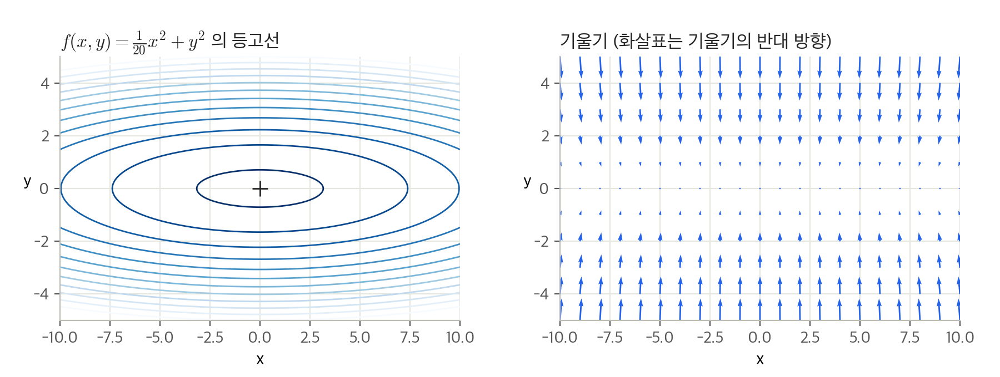

이 함수는 x축 방향으로 길게 늘어진 타원 모양이다. 기울기를 보면 y축 방향은 크고 x축 방향은 작다. 최솟값은 (0, 0)인데 대부분의 위치에서 기울기가 (0, 0)을 가리키지 않는다. 그래서 SGD로 (−7, 2)에서 출발하면 아래 그림의 왼쪽 위처럼 지그재그로 비효율적으로 움직인다.

SGD의 단점은 비등방성(anisotropy) 함수, 즉 방향에 따라 기울기가 달라지는 함수에서는 탐색 경로가 비효율적이라는 것이다. 이 단점을 개선하는 방법으로 모멘텀, AdaGrad, Adam이 나온다.

### 6 - 1 - 4. 모멘텀

모멘텀(Momentum)은 '운동량'이라는 뜻이다.

$$
\mathbf{v} \leftarrow \alpha\mathbf{v} - \eta \frac{\partial L}{\partial \mathbf{W}}, \qquad \mathbf{W} \leftarrow \mathbf{W} + \mathbf{v}
$$

v는 물리에서의 속도에 해당한다. 기울기 방향으로 힘을 받아 물체가 가속되는 것을 나타내고, 공이 그릇의 곡면을 따라 구르는 듯한 움직임을 보인다. $\alpha\mathbf{v}$ 항은 아무 힘도 받지 않을 때 서서히 하강시키는 역할로 지면 마찰이나 공기 저항에 해당하며, $\alpha$는 보통 0.9로 둔다.

```python
class Momentum:
    def __init__(self, lr=0.01, momentum=0.9):
        self.lr = lr
        self.momentum = momentum
        self.v = None

    def update(self, params, grads):
        if self.v is None:
            self.v = {}
            for key, val in params.items():
                self.v[key] = np.zeros_like(val)

        for key in params.keys():
            self.v[key] = self.momentum * self.v[key] - self.lr * grads[key]
            params[key] += self.v[key]
```

v는 처음에는 아무 값도 담지 않고, `update()`가 처음 호출될 때 매개변수와 같은 구조의 데이터를 딕셔너리로 저장한다. x축의 힘은 아주 작지만 방향이 변하지 않아서 한 방향으로 일정하게 가속하고, y축의 힘은 크지만 위아래로 번갈아 받아서 상충하므로 y축 방향의 속도는 안정적이지 않다. 그래서 SGD보다 x축 방향으로 빠르게 다가가 지그재그 움직임이 줄어든다.

### 6 - 1 - 5. AdaGrad

신경망 학습에서는 학습률이 중요하다. 너무 작으면 학습 시간이 길어지고 너무 크면 발산한다. 학습률을 정하는 기술로 학습을 진행하면서 학습률을 점차 줄여가는 학습률 감소(learning rate decay)가 있다. AdaGrad는 이를 발전시켜 '각각의' 매개변수에 '맞춤형' 학습률을 만들어 준다.

$$
\mathbf{h} \leftarrow \mathbf{h} + \frac{\partial L}{\partial \mathbf{W}} \odot \frac{\partial L}{\partial \mathbf{W}}, \qquad
\mathbf{W} \leftarrow \mathbf{W} - \eta \frac{1}{\sqrt{\mathbf{h}}} \frac{\partial L}{\partial \mathbf{W}}
$$

h는 기존 기울기 값을 제곱하여 계속 더해 준다($\odot$은 원소별 곱셈). 매개변수를 갱신할 때 $\frac{1}{\sqrt{\mathbf{h}}}$을 곱해 학습률을 조정하므로, 많이 움직인(크게 갱신된) 원소는 학습률이 낮아진다.

```python
class AdaGrad:
    def __init__(self, lr=0.01):
        self.lr = lr
        self.h = None

    def update(self, params, grads):
        if self.h is None:
            self.h = {}
            for key, val in params.items():
                self.h[key] = np.zeros_like(val)

        for key in params.keys():
            self.h[key] += grads[key] * grads[key]
            params[key] -= self.lr * grads[key] / (np.sqrt(self.h[key]) + 1e-7)
```

마지막 줄에서 1e-7을 더하는 것은 h에 0이 담겨 있어도 0으로 나누는 사태를 막기 위해서이다. AdaGrad는 과거의 기울기를 제곱해서 계속 더하기 때문에 학습을 진행할수록 갱신 강도가 약해지고, 무한히 계속 학습하면 어느 순간 갱신량이 0이 되어 전혀 갱신되지 않는다. 이 문제를 개선한 기법이 먼 과거의 기울기는 서서히 잊고 새로운 기울기 정보를 크게 반영하는 RMSProp이다.

### 6 - 1 - 6. Adam

Adam은 모멘텀과 AdaGrad를 융합한 듯한 방법이다. 두 기법의 이점을 조합해서 매개변수 공간을 효율적으로 탐색하고, 하이퍼파라미터의 '편향 보정'이 진행된다는 점도 특징이다. 하이퍼파라미터는 학습률 $\eta$와 일차 모멘텀용 계수 $\beta_1$(기본 0.9), 이차 모멘텀용 계수 $\beta_2$(기본 0.999)이다.

```python
class Adam:
    def __init__(self, lr=0.001, beta1=0.9, beta2=0.999):
        self.lr = lr
        self.beta1 = beta1
        self.beta2 = beta2
        self.iter = 0
        self.m = None
        self.v = None

    def update(self, params, grads):
        if self.m is None:
            self.m, self.v = {}, {}
            for key, val in params.items():
                self.m[key] = np.zeros_like(val)
                self.v[key] = np.zeros_like(val)

        self.iter += 1
        lr_t = self.lr * np.sqrt(1.0 - self.beta2**self.iter) / (1.0 - self.beta1**self.iter)

        for key in params.keys():
            self.m[key] += (1 - self.beta1) * (grads[key] - self.m[key])
            self.v[key] += (1 - self.beta2) * (grads[key]**2 - self.v[key])
            params[key] -= lr_t * self.m[key] / (np.sqrt(self.v[key]) + 1e-7)
```

### 6 - 1 - 7. 어느 갱신 방법을 이용할 것인가?

네 가지 방법으로 $f(x, y)$의 최솟값을 찾아가는 경로를 직접 그려 보았다. (−7, 2)에서 출발해서 30번 갱신했고, 학습률은 책과 같이 SGD 0.95, 모멘텀 0.1, AdaGrad 1.5, Adam 0.3이다.

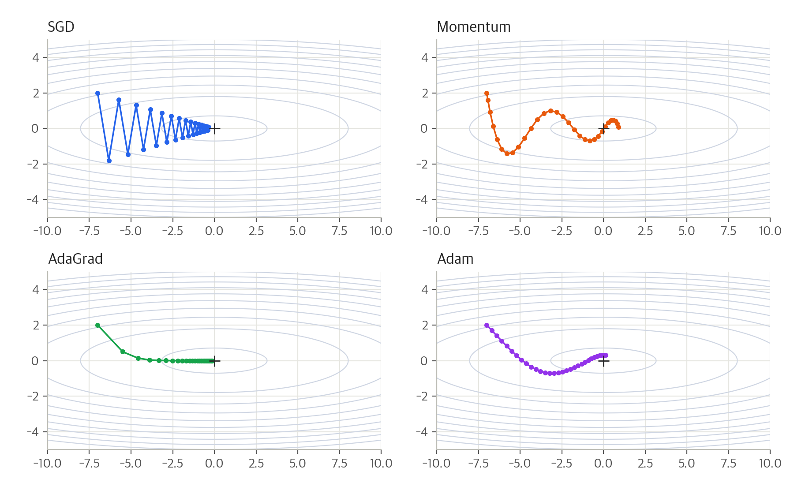

- SGD : y축 방향으로 크게 흔들리면서 지그재그로 이동한다
- 모멘텀 : 공이 그릇 바닥을 구르듯 움직인다. 최솟값을 지나쳤다가 되돌아오지만 x축 방향으로 빠르게 다가간다
- AdaGrad : 처음에 y축 방향으로 크게 움직이지만 그만큼 y축의 학습률이 빠르게 작아져서 지그재그 없이 최솟값으로 향한다
- Adam : 모멘텀처럼 공이 구르는 듯 움직이지만 좌우 흔들림이 적다. 학습률을 매개변수마다 조정해 주기 때문이다

모든 문제에서 항상 뛰어난 기법은 아직 없다. 풀어야 할 문제가 무엇이냐에 따라 적합한 기법이 다르고, 하이퍼파라미터를 어떻게 설정하느냐에 따라서도 결과가 바뀐다. 요즘에는 SGD와 Adam이 많이 쓰인다.

### 6 - 1 - 8. MNIST 데이터셋으로 본 갱신 방법 비교

각 층이 100개의 뉴런으로 구성된 5층 신경망(활성화 함수 ReLU)을 네 가지 방법으로 학습시켜 손실 함수 값의 변화를 비교했다. (digits 데이터, 배치 크기 128, 2,000번 반복, 학습률은 모두 기본값)

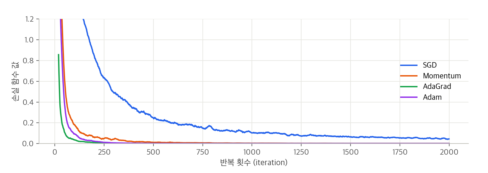

| 갱신 방법 | 200번째 무렵 손실 | 2,000번째 무렵 손실 |
| --- | --- | --- |
| SGD | 0.689 | 0.047 |
| 모멘텀 | 0.053 | 0.001 |
| AdaGrad | 0.008 | 0.000 |
| Adam | 0.015 | 0.000 |

책의 MNIST 결과와 마찬가지로 SGD의 학습 속도가 가장 느리고 나머지 세 기법은 비슷하게 빨랐다. 이번 실험에서는 AdaGrad가 조금 더 빨리 내려갔다. 다만 학습률 같은 하이퍼파라미터와 신경망 구조에 따라 결과는 달라질 수 있다.

## 6 - 2. 가중치의 초깃값

신경망 학습에서 특히 중요한 것이 가중치의 초깃값이다. 초깃값을 무엇으로 설정하느냐가 학습의 성패를 가르는 일이 자주 있다.

### 6 - 2 - 1. 초깃값을 0으로 하면?

오버피팅을 억제해 범용 성능을 높이는 가중치 감소(6 - 4에서 다룸)는 가중치 매개변수의 값이 작아지도록 학습하는 방법이다. 그래서 가중치를 처음부터 작게 시작하는 것이 좋은데, 그렇다면 초깃값을 모두 0으로 하면 어떨까?

결론부터 말하면 안 된다. 정확히는 가중치를 균일한 값으로 설정해서는 안 된다. 오차역전파법에서 모든 가중치의 값이 똑같이 갱신되기 때문이다. 예를 들어 2층 신경망에서 첫 번째 층의 가중치가 모두 0이라면 순전파 때 두 번째 층의 뉴런에 모두 같은 값이 전달되고, 역전파 때 두 번째 층의 가중치가 모두 똑같이 갱신된다(5장의 곱셈 노드의 역전파를 떠올리면 된다). 가중치를 여러 개 갖는 의미가 사라지므로, 이 '가중치가 고르게 되어버리는 상황'을 막으려면 초깃값을 무작위로 설정해야 한다.

### 6 - 2 - 2. 은닉층의 활성화값 분포

가중치의 초깃값에 따라 은닉층 활성화값(활성화 함수의 출력)들이 어떻게 변하는지 보았다. 활성화 함수로 시그모이드 함수를 사용하는 5층 신경망(각 층 뉴런 100개)에 무작위 입력 데이터 1,000개를 흘리고 각 층의 활성화값 분포를 히스토그램으로 그린 것이다.

```python
x = np.random.randn(1000, 100)  # 1000개의 데이터
node_num = 100                  # 각 은닉층의 노드(뉴런) 수
hidden_layer_size = 5           # 은닉층이 5개
activations = {}                # 이곳에 활성화 결과를 저장

for i in range(hidden_layer_size):
    if i != 0:
        x = activations[i-1]

    w = np.random.randn(node_num, node_num) * 1  # 표준편차 1
    # w = np.random.randn(node_num, node_num) * 0.01  # 표준편차 0.01
    # w = np.random.randn(node_num, node_num) * np.sqrt(1.0 / node_num)  # Xavier

    a = np.dot(x, w)
    z = sigmoid(a)
    activations[i] = z
```

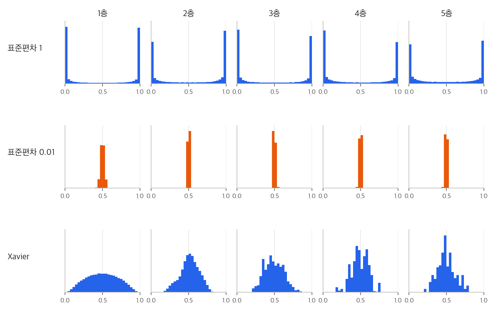

- 표준편차 1 : 활성화값들이 0과 1에 치우쳐 분포한다. 시그모이드 함수는 출력이 0이나 1에 가까워지면 미분이 0에 다가간다. 그래서 역전파의 기울기 값이 점점 작아지다가 사라지는데, 이를 **기울기 소실**(gradient vanishing)이라고 한다
- 표준편차 0.01 : 0.5 부근에 집중된다. 기울기 소실은 없지만 다수의 뉴런이 거의 같은 값을 출력해서 뉴런을 여러 개 둔 의미가 없어진다. 이를 '표현력을 제한'한다고 한다
- Xavier 초깃값 : 앞 층의 노드가 n개라면 표준편차가 $\frac{1}{\sqrt{n}}$인 분포를 사용한다. 층이 깊어지면서 형태가 다소 일그러지지만 앞의 두 방식보다 확실히 넓게 분포한다

각 층의 활성화값은 적당히 고루 분포되어야 층 사이에 적당하게 다양한 데이터가 흐르게 해서 신경망 학습이 효율적으로 이뤄진다. Xavier 초깃값은 일반적인 딥러닝 프레임워크들이 표준적으로 이용하고 있다.

### 6 - 2 - 3. ReLU를 사용할 때의 가중치 초깃값

Xavier 초깃값은 활성화 함수가 선형인 것을 전제로 이끈 결과이다. sigmoid 함수와 tanh 함수는 좌우 대칭이라 중앙 부근이 선형인 함수로 볼 수 있어서 Xavier 초깃값이 적당하다. 반면 ReLU를 이용할 때는 ReLU에 특화된 He 초깃값을 사용하라고 권장한다. He 초깃값은 앞 계층의 노드가 n개일 때 표준편차가 $\sqrt{\frac{2}{n}}$인 정규분포를 사용한다. ReLU는 음의 영역이 0이라서 더 넓게 분포시키기 위해 2배의 계수가 필요하다고 해석할 수 있다.

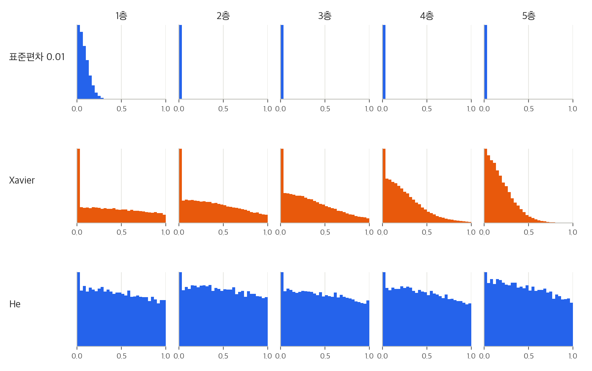

- 표준편차 0.01 : 각 층의 활성화값들이 아주 작은 값들이다. 신경망에 아주 작은 데이터가 흐른다는 것은 역전파 때 가중치의 기울기 역시 작아진다는 뜻이라 학습이 거의 이뤄지지 않는다
- Xavier 초깃값 : 층이 깊어지면서 치우침이 조금씩 커진다. 직접 재 보니 활성화값의 표준편차가 1층 0.57에서 5층 0.14로 줄어들었다. 층이 깊어질수록 기울기 소실이 문제가 된다
- He 초깃값 : 모든 층에서 균일하게 분포했다. 표준편차도 1층 0.81, 5층 0.80으로 거의 그대로였다

정리하면 활성화 함수로 ReLU를 사용할 때는 He 초깃값을, sigmoid나 tanh 등의 S자 모양 곡선일 때는 Xavier 초깃값을 쓴다.

### 6 - 2 - 4. MNIST 데이터셋으로 본 가중치 초깃값 비교

5층 신경망(뉴런 100개씩, ReLU)을 SGD(학습률 0.01)로 학습시키면서 초깃값에 따른 손실 함수 값을 비교했다.

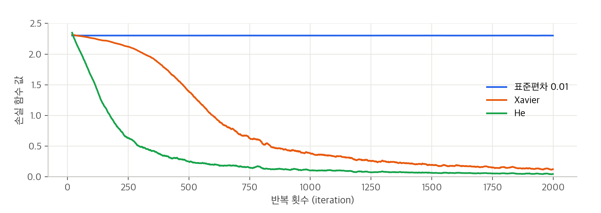

표준편차 0.01일 때는 손실이 2.30에서 전혀 줄지 않아 학습이 전혀 이뤄지지 않았다. 앞에서 본 것처럼 순전파 때 너무 작은 값(0 근처로 밀집한 데이터)이 흐르기 때문이다. Xavier와 He 초깃값은 학습이 순조롭고, He 초깃값 쪽이 학습 진도가 더 빨랐다(2,000번째 무렵 손실 Xavier 0.128, He 0.047). 가중치의 초깃값은 학습 성공 여부를 가르는 중요한 요소이다.

## 6 - 3. 배치 정규화

앞 절에서는 가중치의 초깃값을 적절히 설정해서 각 층의 활성화값 분포가 적당히 퍼지게 했다. 그렇다면 각 층이 활성화를 적당히 퍼뜨리도록 '강제'하면 어떨까? 이 아이디어에서 출발한 것이 배치 정규화(Batch Normalization)이다.

### 6 - 3 - 1. 배치 정규화 알고리즘

배치 정규화는 2015년에 제안된 방법인데 다음과 같은 장점 때문에 주목을 받았다.

- 학습을 빨리 진행할 수 있다 (학습 속도 개선)
- 초깃값에 크게 의존하지 않는다
- 오버피팅을 억제한다 (드롭아웃 등의 필요성 감소)

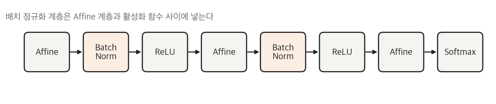

배치 정규화는 학습 시 미니배치를 단위로, 데이터 분포가 평균이 0, 분산이 1이 되도록 정규화한다.

$$
\mu_B \leftarrow \frac{1}{m}\sum_{i=1}^{m} x_i, \qquad
\sigma_B^2 \leftarrow \frac{1}{m}\sum_{i=1}^{m} (x_i - \mu_B)^2, \qquad
\hat{x}_i \leftarrow \frac{x_i - \mu_B}{\sqrt{\sigma_B^2 + \varepsilon}}
$$

미니배치 $B = \{x_1, x_2, \cdots, x_m\}$이라는 m개의 입력 데이터의 집합에 대해 평균 $\mu_B$와 분산 $\sigma_B^2$을 구하고, 입력 데이터를 평균이 0, 분산이 1이 되게 정규화한다. $\varepsilon$은 0으로 나누는 것을 막는 아주 작은 값이다. 이 처리를 활성화 함수의 앞(혹은 뒤)에 넣으면 데이터 분포가 덜 치우치게 할 수 있다.

또 배치 정규화 계층마다 정규화된 데이터에 고유한 확대(scale)와 이동(shift) 변환을 수행한다.

$$
y_i \leftarrow \gamma \hat{x}_i + \beta
$$

$\gamma$와 $\beta$는 매개변수로, 처음에는 $\gamma = 1$, $\beta = 0$부터 시작하고 학습하면서 적합한 값으로 조정해 간다. 배치 정규화의 역전파는 계산 그래프가 조금 복잡하지만 5장처럼 계산 그래프를 그려서 노드별로 따라가면 구할 수 있다.

### 6 - 3 - 2. 배치 정규화의 효과

가중치 초깃값의 표준편차를 1부터 0.0001까지 16가지로 바꿔 가며, 배치 정규화 계층을 넣은 경우와 넣지 않은 경우의 학습 진도를 비교했다. (5층 신경망, 훈련 데이터 1,000개, SGD 학습률 0.01, 20에폭)

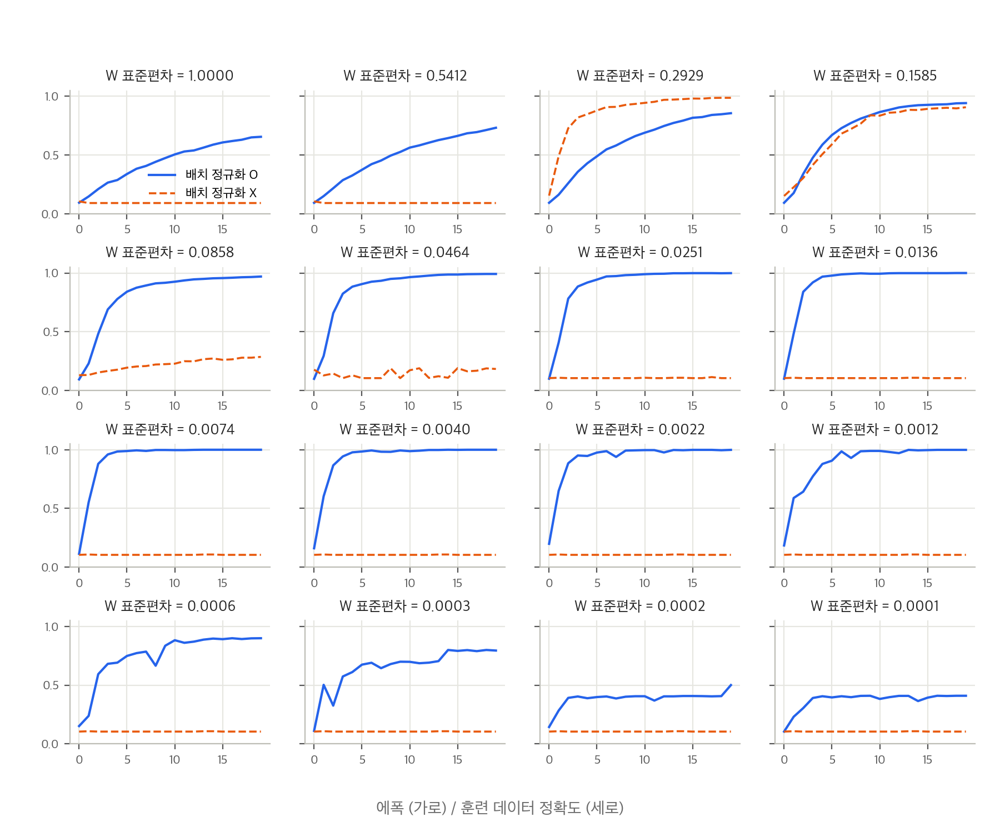

거의 모든 경우에서 배치 정규화를 사용할 때(실선)의 학습 진도가 빨랐다. 배치 정규화를 이용하지 않으면 초깃값이 잘 분포되어 있지 않은 경우 학습이 전혀 진행되지 않았다(정확도 0.1 근처). 표준편차 1과 0.54에서는 배치 정규화 없이 학습하면 값이 발산해 버리기도 했다. 표준편차 0.29에서만 배치 정규화를 쓰지 않은 쪽이 더 좋았는데, 이 값은 He 초깃값($\sqrt{2/n}$, 여기서는 0.14~0.18)과 크기가 비슷해서 배치 정규화 없이도 활성화값이 적당히 퍼진 경우라고 볼 수 있다. 배치 정규화를 사용하면 학습이 빨라지고 가중치 초깃값에 크게 의존하지 않아도 된다.

## 6 - 4. 바른 학습을 위해

기계학습에서는 오버피팅이 문제가 되는 일이 많다. 오버피팅이란 신경망이 훈련 데이터에만 지나치게 적응되어 그 외의 데이터에는 제대로 대응하지 못하는 상태를 말한다.

### 6 - 4 - 1. 오버피팅

오버피팅은 주로 다음 두 경우에 일어난다.

- 매개변수가 많고 표현력이 높은 모델
- 훈련 데이터가 적은 경우

일부러 두 조건을 충족해 오버피팅을 일으켜 보았다. 훈련 데이터를 300개만 사용하고, 은닉층 6개(뉴런 100개씩)인 7층 신경망을 SGD(학습률 0.01)로 201에폭 학습시켰다. 아래 그림의 왼쪽이 그 결과이다.

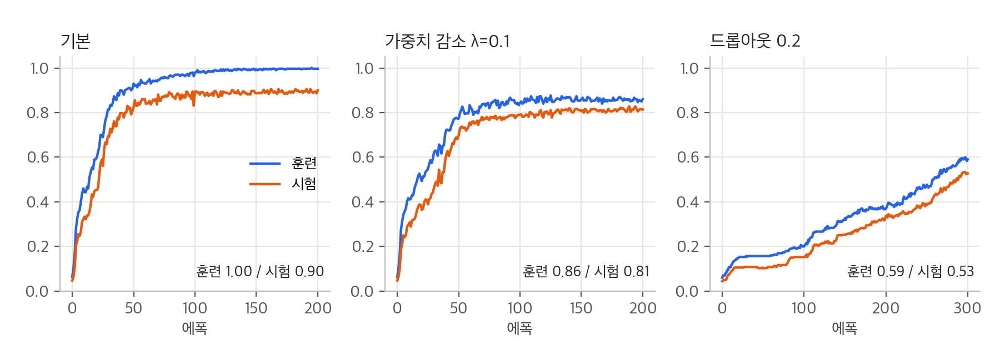

훈련 데이터의 정확도는 100%에 가깝지만(0.997) 시험 데이터의 정확도는 0.90에 머물러 차이가 크게 벌어진다. 훈련 데이터에만 적응해 버린 것이다.

### 6 - 4 - 2. 가중치 감소

오버피팅 억제용으로 예로부터 많이 이용해 온 방법 중 가중치 감소(weight decay)가 있다. 학습 과정에서 큰 가중치에 대해서는 그에 상응하는 큰 페널티를 부과하여 오버피팅을 억제하는 방법이다. 원래 오버피팅은 가중치 매개변수의 값이 커서 발생하는 경우가 많기 때문이다.

손실 함수에 가중치의 제곱 노름(L2 노름)을 더하면 가중치가 커지는 것을 억제할 수 있다. 가중치를 W라 하면 L2 노름에 따른 가중치 감소는 $\frac{1}{2}\lambda\mathbf{W}^2$이 되고, 이를 손실 함수에 더한다. $\lambda$는 정규화의 세기를 조절하는 하이퍼파라미터로 크게 설정할수록 큰 가중치에 대한 페널티가 커진다. 앞의 $\frac{1}{2}$은 미분 결과인 $\lambda\mathbf{W}$를 조정하는 역할의 상수이다.

```python
# 손실 함수에 가중치 감소 항을 더한다
weight_decay = 0
for idx in range(1, self.hidden_layer_num + 2):
    W = self.params['W' + str(idx)]
    weight_decay += 0.5 * self.weight_decay_lambda * np.sum(W ** 2)
loss = self.last_layer.forward(y, t) + weight_decay

# 기울기에도 미분 결과인 λW를 더한다
grads['W' + str(idx)] = self.layers['Affine' + str(idx)].dW + self.weight_decay_lambda * self.layers['Affine' + str(idx)].W
```

$\lambda = 0.1$로 가중치 감소를 적용한 결과가 위 그림의 가운데이다. 훈련 데이터와 시험 데이터의 정확도 차이가 0.10에서 0.05로 줄었다. 다만 훈련 데이터의 정확도가 100%에 도달하지 못하고 0.86에 머물렀고, 이번 실험에서는 시험 정확도도 0.81로 오히려 낮아졌다. $\lambda$가 너무 커서 모델이 덜 학습된 것으로 보인다.

### 6 - 4 - 3. 드롭아웃

가중치 감소는 간단하게 구현할 수 있고 어느 정도 오버피팅을 억제할 수 있지만, 신경망 모델이 복잡해지면 가중치 감소만으로는 대응하기 어려워진다. 이럴 때는 흔히 드롭아웃(Dropout)이라는 기법을 이용한다.

드롭아웃은 뉴런을 임의로 삭제하면서 학습하는 방법이다. 훈련 때 은닉층의 뉴런을 무작위로 골라 삭제하고, 삭제된 뉴런은 신호를 전달하지 않게 된다. 훈련 때는 데이터를 흘릴 때마다 삭제할 뉴런을 무작위로 선택하고, 시험 때는 모든 뉴런에 신호를 전달한다. 단, 시험 때는 각 뉴런의 출력에 훈련 때 삭제 안 한 비율을 곱하여 출력한다.

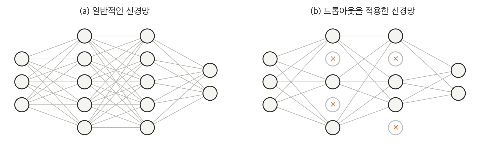

```python
class Dropout:
    def __init__(self, dropout_ratio=0.5):
        self.dropout_ratio = dropout_ratio
        self.mask = None

    def forward(self, x, train_flg=True):
        if train_flg:
            self.mask = np.random.rand(*x.shape) > self.dropout_ratio
            return x * self.mask
        else:
            return x * (1.0 - self.dropout_ratio)

    def backward(self, dout):
        return dout * self.mask
```

훈련 시에는 순전파 때마다 `self.mask`에 삭제할 뉴런을 False로 표시한다. `self.mask`는 x와 형상이 같은 배열을 무작위로 생성하고 그 값이 `dropout_ratio`보다 큰 원소만 True로 설정한다. 역전파 때의 동작은 ReLU와 같다. 순전파 때 신호를 통과시키는 뉴런은 역전파 때도 신호를 그대로 통과시키고, 순전파 때 통과시키지 않은 뉴런은 역전파 때도 신호를 차단한다.

드롭아웃 비율 0.2로 301에폭 학습시킨 결과가 위 그림의 오른쪽이다. 훈련과 시험 정확도의 차이는 0.06으로 줄었지만, 뉴런을 계속 끄면서 학습하다 보니 학습 자체가 느려져서 301에폭이 지나도 정확도가 0.6 근처에 머물렀다. 오버피팅을 막는 대신 더 오래 학습해야 한다는 것을 알 수 있었다.

기계학습에서는 앙상블 학습(ensemble learning)을 애용한다. 개별적으로 학습시킨 여러 모델의 출력을 평균 내어 추론하는 방식이다. 드롭아웃은 학습 때 뉴런을 무작위로 삭제하는 행위를 매번 다른 모델을 학습시키는 것으로 해석할 수 있고, 추론 때는 뉴런의 출력에 삭제한 비율을 곱해서 앙상블 학습에서 여러 모델의 평균을 내는 것과 같은 효과를 얻는다. 즉 드롭아웃은 앙상블 학습과 같은 효과를 하나의 네트워크로 구현했다고 생각할 수 있다.

## 6 - 5. 적절한 하이퍼파라미터 값 찾기

신경망에는 하이퍼파라미터가 다수 등장한다. 각 층의 뉴런 수, 배치 크기, 매개변수 갱신 시의 학습률과 가중치 감소 등이다. 하이퍼파라미터 값을 적절히 설정하지 않으면 모델의 성능이 크게 떨어지기도 한다.

### 6 - 5 - 1. 검증 데이터

하이퍼파라미터의 성능을 평가할 때는 시험 데이터를 사용해서는 안 된다. 시험 데이터를 사용하여 하이퍼파라미터를 조정하면 하이퍼파라미터 값이 시험 데이터에 오버피팅되기 때문이다. 그래서 하이퍼파라미터 조정용 데이터를 따로 두는데, 이를 검증 데이터(validation data)라고 한다.

| 데이터 | 용도 |
| --- | --- |
| 훈련 데이터 | 매개변수(가중치와 편향)의 학습 |
| 검증 데이터 | 하이퍼파라미터 성능 평가 |
| 시험 데이터 | 신경망의 범용 성능 평가 (마지막에 한 번만) |

데이터셋에 따라 검증 데이터를 따로 주지 않는 경우가 있는데, 그럴 때는 훈련 데이터 중 20% 정도를 검증 데이터로 먼저 분리한다.

```python
(x_train, t_train), (x_test, t_test) = load_mnist()

# 훈련 데이터를 뒤섞는다.
x_train, t_train = shuffle_dataset(x_train, t_train)

# 20%를 검증 데이터로 분할
validation_rate = 0.20
validation_num = int(x_train.shape[0] * validation_rate)

x_val = x_train[:validation_num]
t_val = t_train[:validation_num]
x_train = x_train[validation_num:]
t_train = t_train[validation_num:]
```

### 6 - 5 - 2. 하이퍼파라미터 최적화

하이퍼파라미터를 최적화할 때의 핵심은 하이퍼파라미터의 '최적 값'이 존재하는 범위를 조금씩 줄여간다는 것이다. 대략적인 범위를 설정하고 그 범위에서 무작위로 하이퍼파라미터 값을 골라낸(샘플링) 후, 그 값으로 정확도를 평가한다. 신경망의 하이퍼파라미터 최적화에서는 그리드 서치 같은 규칙적인 탐색보다 무작위로 샘플링해 탐색하는 편이 좋은 결과를 낸다고 알려져 있다. 최종 정확도에 미치는 영향력이 하이퍼파라미터마다 다르기 때문이다.

하이퍼파라미터의 범위는 '대략적으로' 지정하는 것이 효과적이다. 0.001에서 1,000 사이($10^{-3} \sim 10^{3}$)처럼 10의 거듭제곱 단위로 범위를 지정하는데, 이를 로그 스케일(log scale)로 지정한다고 한다.

1) 하이퍼파라미터 값의 범위를 설정한다
2) 설정된 범위에서 하이퍼파라미터의 값을 무작위로 추출한다
3) 2단계에서 샘플링한 하이퍼파라미터 값을 사용하여 학습하고, 검증 데이터로 정확도를 평가한다 (단, 에폭은 작게 설정한다)
4) 2단계와 3단계를 특정 횟수 반복하여, 그 정확도의 결과를 보고 하이퍼파라미터의 범위를 좁힌다

딥러닝 학습에는 오랜 시간이 걸리므로 나쁠 듯한 값은 일찍 포기하고, 에폭을 작게 하여 1회 평가에 걸리는 시간을 단축하는 것이 효과적이다.

### 6 - 5 - 3. 하이퍼파라미터 최적화 구현하기

학습률과 가중치 감소의 세기를 조절하는 계수를 탐색하는 문제를 풀어 보았다. 가중치 감소 계수를 $10^{-8} \sim 10^{-4}$, 학습률을 $10^{-6} \sim 10^{-2}$ 범위에서 무작위로 추출한다.

```python
weight_decay = 10 ** np.random.uniform(-8, -4)
lr = 10 ** np.random.uniform(-6, -2)
```

훈련 데이터 500개 중 20%(100개)를 검증 데이터로 떼어 두고, 7층 신경망을 50에폭씩 100번 학습시켰다.

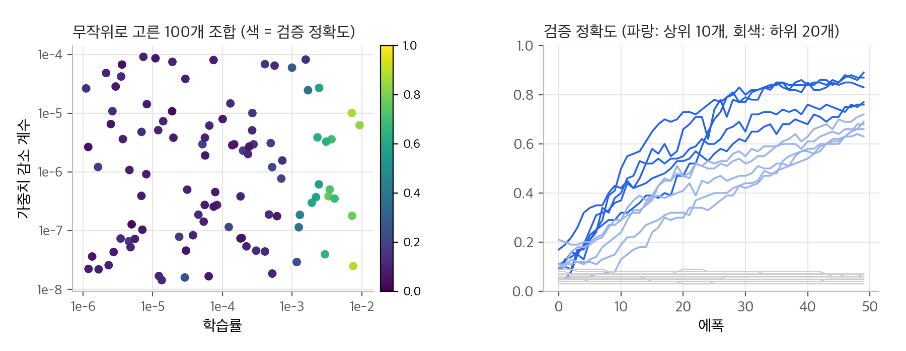

| 순위 | 검증 정확도 | 학습률 | 가중치 감소 계수 |
| --- | --- | --- | --- |
| 1 | 0.89 | 7.6e-03 | 2.5e-08 |
| 2 | 0.87 | 7.2e-03 | 1.0e-05 |
| 3 | 0.83 | 9.3e-03 | 6.3e-06 |
| 4 | 0.77 | 7.3e-03 | 1.8e-07 |
| 5 | 0.76 | 3.3e-03 | 3.9e-07 |

왼쪽 그림을 보면 학습률이 0.001보다 작은 쪽은 거의 다 실패했고(100번 중 76번이 검증 정확도 0.2 미만), 잘 된 조합은 모두 학습률이 0.003에서 0.01 사이였다. 반면 가중치 감소 계수는 위아래로 흩어져 있어 이 범위에서는 결과에 큰 영향을 주지 않았다. 따라서 다음에는 학습률 범위를 0.001에서 0.01 사이로 좁혀서 같은 작업을 반복하면 된다. 책의 MNIST 결과에서도 학습률 0.001~0.01, 가중치 감소 계수 $10^{-8} \sim 10^{-6}$ 정도에서 학습이 잘 진행되었다.

## 6 - 6. 정리

- 매개변수 갱신 방법에는 확률적 경사 하강법(SGD) 외에도 모멘텀, AdaGrad, Adam 등이 있다
- 가중치 초깃값을 정하는 방법은 올바른 학습을 하는 데 매우 중요하다
- 가중치의 초깃값으로는 Xavier 초깃값과 He 초깃값이 효과적이다
- 배치 정규화를 이용하면 학습을 빠르게 진행할 수 있으며, 초깃값에 영향을 덜 받게 된다
- 오버피팅을 억제하는 정규화 기술로는 가중치 감소와 드롭아웃이 있다
- 하이퍼파라미터 값 탐색은 최적 값이 존재할 법한 범위를 점차 좁히면서 하는 것이 효과적이다

| 기술 | 해결하려는 문제 | 핵심 아이디어 |
| --- | --- | --- |
| 모멘텀 | SGD의 지그재그 이동 | 이전 갱신 방향(속도)을 이어서 쓴다 |
| AdaGrad | 매개변수마다 적절한 학습률이 다름 | 많이 갱신된 매개변수의 학습률을 줄인다 |
| Adam | 위 두 문제 | 모멘텀 + AdaGrad, 편향 보정 |
| Xavier / He 초깃값 | 활성화값 치우침, 기울기 소실 | 앞 층 노드 수 n에 맞춰 표준편차를 $\frac{1}{\sqrt{n}}$, $\sqrt{\frac{2}{n}}$로 |
| 배치 정규화 | 초깃값 의존, 느린 학습 | 미니배치마다 평균 0, 분산 1로 정규화 |
| 가중치 감소 | 오버피팅 | 손실 함수에 $\frac{1}{2}\lambda\mathbf{W}^2$ 페널티 |
| 드롭아웃 | 오버피팅 (복잡한 모델) | 훈련 때 뉴런을 무작위로 삭제 |
| 검증 데이터 + 무작위 탐색 | 하이퍼파라미터 선택 | 로그 스케일 범위를 점점 좁힌다 |

## 내 생각

**1. 갱신 방법에 따라 추가로 필요한 메모리**

5장에서 오차역전파법의 메모리 비용을 계산하면서, 갱신 방법에 따라 추가로 필요한 메모리도 살펴보기로 했었다. 이번 장의 코드를 보면 SGD는 따로 저장하는 것이 없지만 모멘텀은 v, AdaGrad는 h, Adam은 m과 v를 매개변수와 같은 형상으로 가지고 있다. 즉 매개변수 수만큼의 메모리가 모멘텀과 AdaGrad는 1배, Adam은 2배 더 필요하다.

5장에서 쓴 784-50-10 신경망(매개변수 39,760개)을 float32로 배치 1로 학습한다고 하고, 5장에서 잰 값(매개변수 + 기울기 + 역전파용 저장값 약 314 KB)에 더해 보았다.

| 갱신 방법 | 추가로 저장하는 값 | 추가 메모리 | 학습에 필요한 메모리 합계 |
| --- | --- | --- | --- |
| SGD | 없음 | 0 KB | 약 314 KB |
| 모멘텀 | v | 155.3 KB | 약 469 KB |
| AdaGrad | h | 155.3 KB | 약 469 KB |
| Adam | m, v | 310.6 KB | 약 625 KB |

이번 장의 실험에서 Adam은 SGD보다 훨씬 빨리 손실을 줄였지만, 메모리는 매개변수의 3배(매개변수 + m + v)를 쓴다. PC에서는 아무 문제가 없는 크기지만 RAM이 256 KB 정도인 MCU라면 SGD로도 빠듯한 신경망이 Adam으로는 두 배 넘게 초과한다. 5장에서 본 '계산 시간을 메모리로 바꾸는' 관계가 갱신 방법에서도 똑같이 나타나는 셈이다. 그래서 MCU처럼 메모리가 부족한 환경에서 학습을 한다면 빠르게 수렴하는 Adam보다 오히려 상태를 저장하지 않는 SGD(또는 모멘텀 정도)를 쓰는 것이 현실적일 것 같다.

**2. 초깃값과 배치 정규화가 생각보다 중요했다**

가장 인상 깊었던 것은 초깃값 표준편차 0.01일 때 손실이 2.30에서 단 한 번도 내려가지 않은 결과였다. 코드는 똑같고 처음에 곱하는 숫자 하나만 바뀌었는데 학습이 아예 안 된다는 것이 신기했다. 2.30은 $-\log 0.1$로, 10개 클래스를 모두 같은 확률로 찍는 상태의 교차 엔트로피 오차와 같다. 즉 신경망이 아무것도 배우지 못하고 찍고만 있는 상태가 끝까지 유지된 것이다.

배치 정규화 실험에서는 16개의 초깃값 중 배치 정규화가 없으면 2개 정도에서만 학습이 제대로 되었지만, 배치 정규화를 넣으면 대부분에서 학습이 되었다. 3장에서 '학습한다'는 말을 듣고 지능을 기대했다가 결국 숫자의 연산이라고 느꼈는데, 이번 장을 보니 그 숫자들이 '잘 흐르도록' 만드는 것 자체가 하나의 기술이라는 생각이 들었다. 다음 장에서는 이미지 인식에 쓰이는 합성곱 신경망(CNN)을 다루는데, 층이 더 깊어지면 이번 장의 기술들이 어떻게 쓰이는지 확인해 볼 계획이다.
