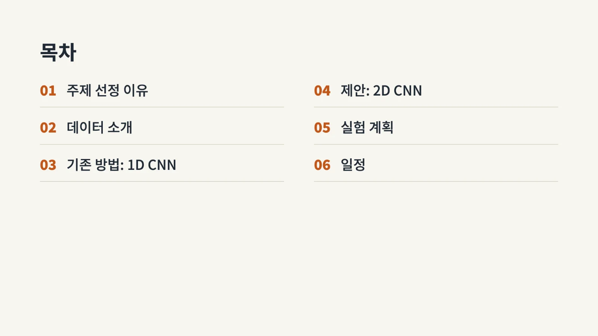
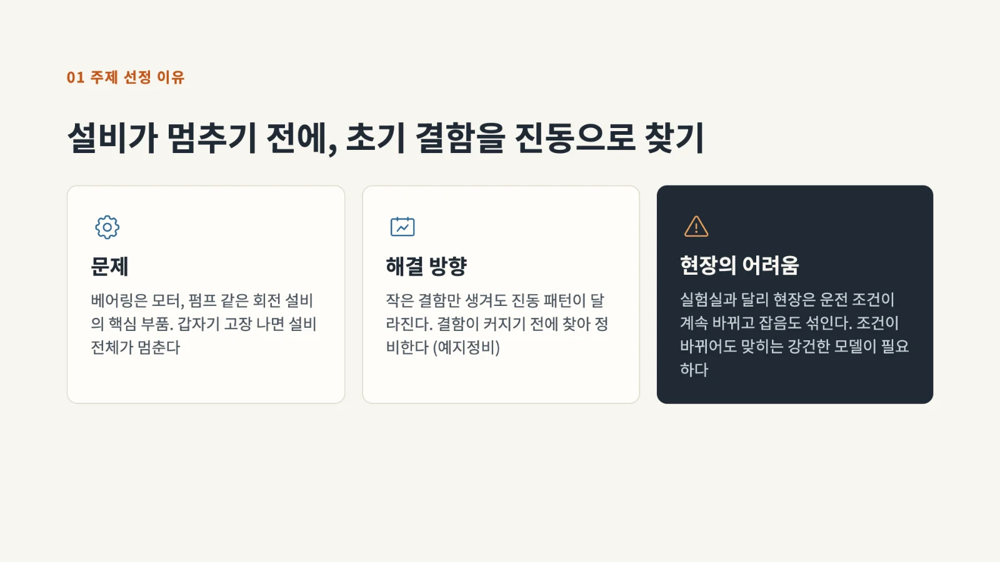
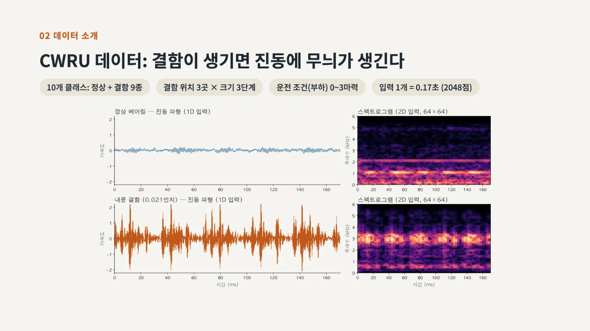
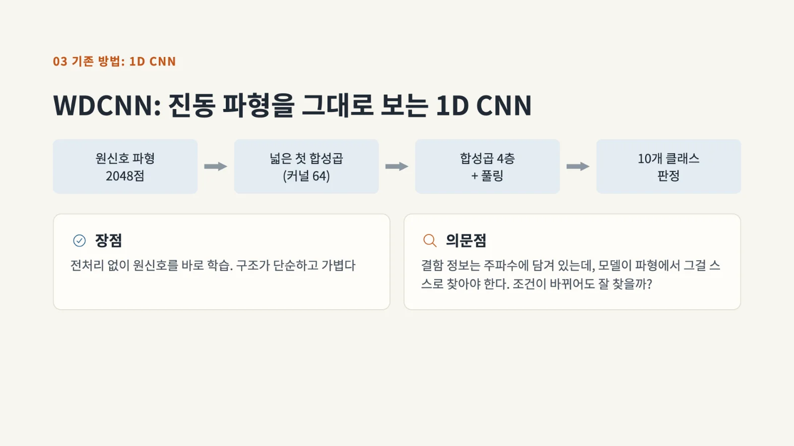
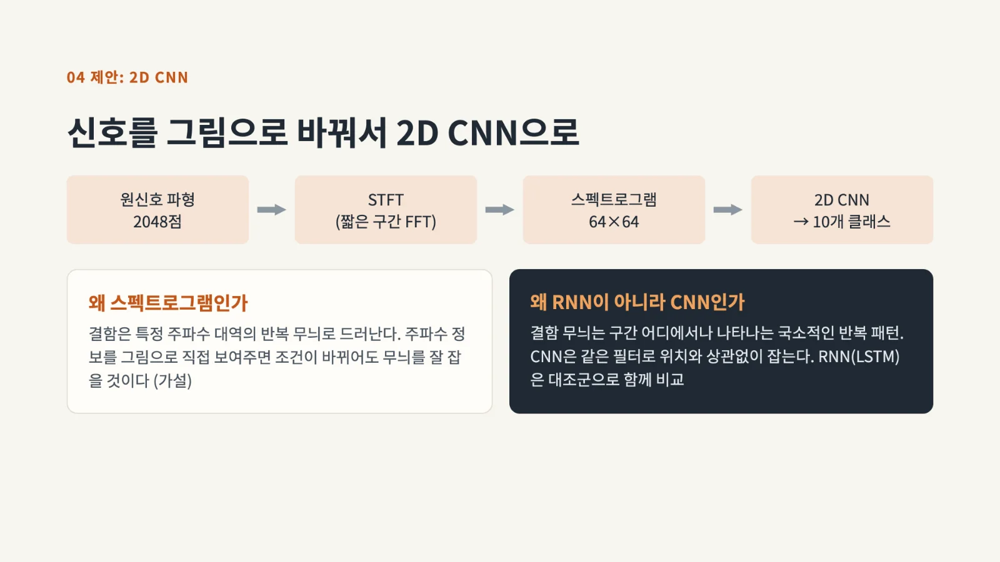
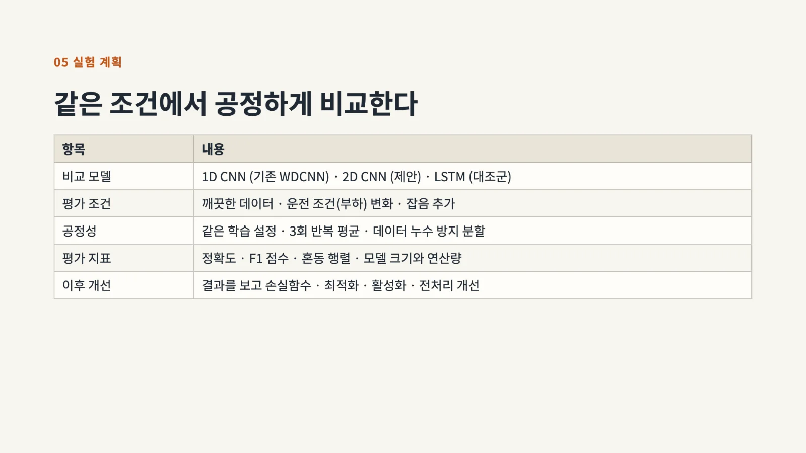
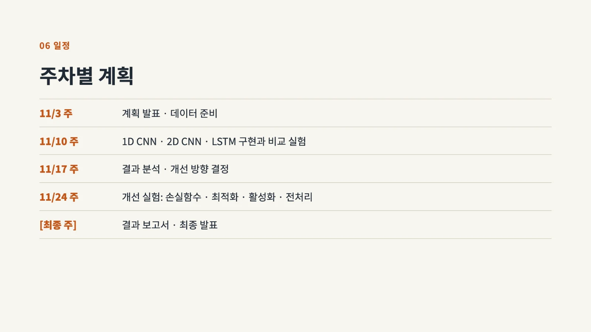

[PDF 원본 받기 · 8쪽 · 1.4MB](/files/%EB%B0%91%EB%B0%94%EB%8B%A5%EB%B6%80%ED%84%B0-%EC%8B%9C%EC%9E%91%ED%95%98%EB%8A%94-%EB%94%A5%EB%9F%AC%EB%8B%9D/%EC%8A%A4%ED%8E%99%ED%8A%B8%EB%A1%9C%EA%B7%B8%EB%9E%A8-%EB%B2%A0%EC%96%B4%EB%A7%81-%EA%B3%A0%EC%9E%A5%EC%A7%84%EB%8B%A8-%EA%B3%84%ED%9A%8D-%EB%B0%9C%ED%91%9C/%EC%8A%A4%ED%8E%99%ED%8A%B8%EB%A1%9C%EA%B7%B8%EB%9E%A8%20%EB%B2%A0%EC%96%B4%EB%A7%81%20%EA%B3%A0%EC%9E%A5%EC%A7%84%EB%8B%A8%20%EA%B3%84%ED%9A%8D%20%EB%B0%9C%ED%91%9C.pdf)

